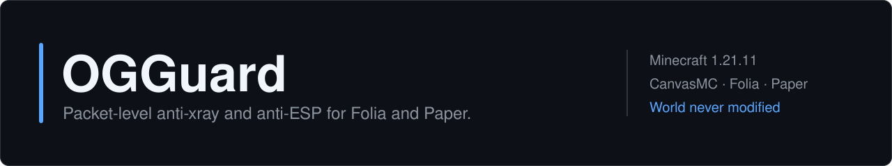

<p align="center">
  
</p>

<p align="center">
  <a href="https://github.com/esermedias/OGGuard/releases/latest"></a>
  <a href="https://github.com/esermedias/OGGuard/releases"></a>
  <a href="https://github.com/esermedias/OGGuard/actions/workflows/build.yml"></a>
  <a href="LICENSE"></a>
</p>

<p align="center">
  
  
  
  
  
  
</p>

<p align="center">
  
  
  <a href="https://github.com/esermedias/OGGuard/stargazers"></a>
  <a href="https://esuh.wtf/"></a>
  <a href="https://discord.gg/addons"></a>
  <a href="#support-and-contact"></a>
</p>

OGGuard is a packet-level anti-xray and anti-ESP plugin for Minecraft 1.21.11 servers running CanvasMC, Folia or Paper. Instead of scrambling ores, it doesn't send what a player has no business seeing: underground bases below Y=0, and containers that are out of range or out of sight. Base finders, storage ESP and xray have nothing to read because the data never reaches the client.

The world on disk is never touched. OGGuard rewrites only the packets that go to each player, and only where it has to.

## Contents

- [How it works](#how-it-works)
- [Requirements](#requirements)
- [Installation](#installation)
- [Configuration](#configuration)
- [Commands and permissions](#commands-and-permissions)
- [API for other plugins](#api-for-other-plugins)
- [Building from source](#building-from-source)
- [Design notes](#design-notes)
- [Support and contact](#support-and-contact)
- [License](#license)

## How it works

### Underground concealment

Everything below `boundary-y` (Y=0 by default) is sent as deepslate to players who aren't down there themselves.

- A player whose feet drop below `reveal-enter-y` (Y=4) receives the real data for chunks within `reveal-radius-chunks` (3) of them. They're concealed again once they climb back to `conceal-exit-y` (Y=12). The gap stops the view from flickering at the edge.
- With a survival reach of 4.5 blocks, a concealed player can never touch a block below Y=0, so nobody mines a fake block.
- Masked sections are rebuilt with a fresh block palette. No palette entry of a hidden block survives, so the packet doesn't even reveal which block types exist down there.
- Light in masked sections is zeroed, so torches and lamps inside a base don't outline its shape.
- Block entities, entities, players, block events, break progress, sounds and particles at hidden positions are filtered out. Entities that come back into view are replayed with their cached spawn, metadata, equipment and passengers.

You can protect everything below the boundary, or only specific regions from the config or another plugin.

### Container concealment

Chests, shulker boxes, barrels, furnaces, hoppers and the other configured types are sent only while the container is within `max-distance` (24 blocks) of the player's eyes and in line of sight. Rays through opaque full blocks count as blocked.

Until then the chunk carries the block without its block entity, and with `replace-block` the container itself is sent as deepslate, so storage ESP that reads block states has nothing to draw through walls. When the container comes into view, its chunk is resent with the real block on the player's region thread.

### Fail closed

If rewriting a packet throws, the packet is dropped and logged (rate-limited) instead of being sent unmasked. If the server's internals don't match the verified 1.21.11 layout, OGGuard refuses to start rather than run half-working. If the packet handler can't be installed for a player, that player is disconnected with a rejoin message.

## Requirements

| | |
| :--- | :--- |
| Minecraft | 1.21.11 |
| Server | CanvasMC, Folia or Paper 1.21.11 |
| Java | 21 or newer |

OGGuard is developed and run on CanvasMC 1.21.11. It builds against the Paper 1.21.11 API and only uses scheduler APIs that Folia and Paper share, but CanvasMC is where it has been run in production.

## Installation

1. Download `OGGuard-<version>.jar` from the [latest release](https://github.com/esermedias/OGGuard/releases/latest).
2. Put it in your server's `plugins/` folder and restart.
3. Check the console for `Packet visibility active: ...`.
4. Run `/ogguard selftest` in a loaded area. Every line should start with `PASS` or `INFO`.
5. Adjust `plugins/OGGuard/config.yml` and run `/ogguard reload`.

## Configuration

All options live under `packet-visibility` in `config.yml`. The defaults protect everything below Y=0 in every world.

| Option | Default | What it does |
| :--- | :--- | :--- |
| `enabled` | `true` | Master switch. |
| `boundary-y` | `0` | Blocks with y below this can be protected. |
| `reveal-enter-y` | `4` | A player whose feet drop below this sees real geometry around them. |
| `conceal-exit-y` | `12` | A revealed player is concealed again at this height. |
| `reveal-radius-chunks` | `3` | Radius, in chunks, of real data around a revealed player. |
| `replacement` | `DEEPSLATE` | `AIR`, `STONE` or `DEEPSLATE`. |
| `protect-all-below-boundary` | `true` | `false` protects only `protected-regions` and API regions. |
| `worlds` | `[]` | Worlds covered. Empty means all. |
| `excluded-worlds` | `[]` | Worlds OGGuard never touches, for example a spawn or lobby world. |
| `hide-block-entities` / `hide-entities` / `hide-players` | `true` | What else is hidden at protected positions. |
| `mask-light` | `true` | Zero light in masked sections. |
| `filter-effects` | `true` | Drop sounds, particles and block events at hidden positions. |
| `update-period-ticks` | `5` | How often each player's state is recomputed. |
| `protected-regions` | `[]` | Cuboids to protect when `protect-all-below-boundary` is off. |
| `reveal-zones` | `[]` | Standing inside one reveals nearby geometry at any height. |
| `container-concealment.enabled` | `true` | Container concealment switch. |
| `container-concealment.max-distance` | `24` | Range, in blocks, from the player's eyes. |
| `container-concealment.check-interval-ticks` | `4` | How often line of sight is checked. |
| `container-concealment.replace-block` | `true` | Also send hidden containers as `replacement-block`. |
| `container-concealment.block-entity-types` | chest, barrel, shulker_box, ... | Block entity types to conceal. |

Invalid values are rejected: at startup OGGuard disables itself with the reason in the console, and a failed `/ogguard reload` keeps the previous settings.

## Commands and permissions

| Command | Permission | What it does |
| :--- | :--- | :--- |
| `/ogguard status` | `ogguard.admin` | Current settings, sessions and, for players, their own visibility state. |
| `/ogguard reload` | `ogguard.admin` | Reloads `config.yml` and resyncs online players. |
| `/ogguard selftest` | `ogguard.admin` | Masks a real chunk packet at your position, decodes it with the server's codec and compares every block. Read-only. |

| Permission | Default | |
| :--- | :--- | :--- |
| `ogguard.admin` | op | Use `/ogguard`. |
| `ogguard.bypass` | nobody | Receive real underground data everywhere. Give it to staff who need it; operators don't get it automatically. |

## API for other plugins

With `protect-all-below-boundary: false`, other plugins can register the regions to protect at runtime, for example a base or claim plugin protecting the underground part of a base:

```java
GuardApi guard = Bukkit.getServicesManager().load(GuardApi.class);
if (guard != null) {
    guard.putProtectedRegion("base:" + owner, Cuboid.of("world", 100, -64, 100, 160, -1, 160));
}
```

Regions only apply below `boundary-y`. The API is thread-safe, and changes trigger a resync for online players on their own region threads.

## Building from source

```bash
./gradlew build
```

The build uses [paperweight-userdev](https://github.com/PaperMC/paperweight) with the Paper 1.21.11 dev bundle, so the first run downloads and sets up the Mojang-mapped server. The jar ends up in `build/libs/`. Releases are built by GitHub Actions from version tags.

## Design notes

- **Threading.** Player state is computed on the player's own region thread and published as an immutable snapshot. Chunks are read, and resend packets built, only on the region thread that owns them. The Netty handler only reads snapshots and never calls Bukkit or touches the world.
- **Pure policy.** Every visibility decision lives in a policy layer with no Netty, Bukkit or Minecraft imports. That layer is covered by 85 unit tests.
- **Cheap when idle.** Sections that need no masking are copied byte for byte, and a packet with nothing to hide is forwarded as-is.
- **No guessing on the wire.** The private packet fields it reads were checked against the 1.21.11 server, and rewritten packets are rebuilt through the server's own codecs.

## Support and contact

- **Discord server:** [discord.gg/addons](https://discord.gg/addons)
- **Direct contact:** Discord `esuhdev.`
- **Bugs:** open an [issue](https://github.com/esermedias/OGGuard/issues) with your server software, version and the output of `/ogguard selftest`.
- **Website:** [esuh.wtf](https://esuh.wtf/)

## License

[MIT](LICENSE)

<p align="center">
  <sub>Made by <a href="https://esuh.wtf/">esuh</a></sub>
</p>
